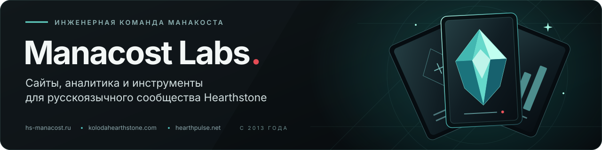

  

  <b>Инженерная команда Манакоста.</b> 
  С 2013 года делаем сайты, аналитику и инструменты для русскоязычных игроков Hearthstone.

  
  
  
  
  

## Продукты

<table>
  <tr>
    <td width="33%" valign="top">
      <h4><a href="https://hs-manacost.ru/">HS-Manacost</a></h4>
      Новости и разборы патчей, актуальные колоды, гайды по Стандарту, Вольному, Арене и Полям сражений.
    </td>
    <td width="33%" valign="top">
      <h4><a href="https://kolodahearthstone.com/">KolodaHearthstone</a></h4>
      Авторская аналитика: мета-отчёты, тир-листы и подробные гайды для тех, кто хочет понимать игру глубже.
    </td>
    <td width="33%" valign="top">
      <h4><a href="https://hearthpulse.net/">HearthPulse</a></h4>
      Статистика в цифрах: винрейты классов и тир-лист карт Арены, мета Полей сражений, Стандарта и Вольного.
    </td>
  </tr>
</table>

## Открытый код

| | Проект | Что делает | Стек |
|---|---|---|---|
| **Данные** | [HeartPulse](https://github.com/Manacost-Labs/HeartPulse) | Сайт аналитики HearthPulse: Арена, Поля сражений, мета и тир-листы | TypeScript · React · Node.js |
| | [api.kolodahearthstone.com](https://github.com/Manacost-Labs/api.kolodahearthstone.com) | Платформа данных Hearthstone: REST/GraphQL API, парсеры, веб-панель | Python · FastAPI · PostgreSQL |
| | [hearthstone-deckstrings](https://github.com/Manacost-Labs/hearthstone-deckstrings) | Кодеки кодов колод с общим проверенным контрактом | TypeScript · PHP · Python · .NET |
| | [ParsesUnix](https://github.com/Manacost-Labs/ParsesUnix) | Фреймворк сбора данных из веба с контролем качества и затрат | Python |
| **Контент** | [Deckview-TG](https://github.com/Manacost-Labs/Deckview-TG) | Telegram-бот и HTTP API для красивых изображений колод | Python · Pillow · Redis |
| | [card-v2](https://github.com/Manacost-Labs/card-v2) | Изображения карт в высоком разрешении через Real-ESRGAN | Python |
| | [extract-hs](https://github.com/Manacost-Labs/extract-hs) | Просмотр и выгрузка ресурсов клиента игры | TypeScript · Python |
| | [motion-studio](https://github.com/Manacost-Labs/motion-studio) | Видеоролики из сцен, озвучки и данных | TypeScript · Remotion |
| | [AICover](https://github.com/Manacost-Labs/AICover) | Генератор обложек на Gemini: слияние, апскейл, расширение кадра | TypeScript · React |
| **Сервисы** | [AntiSpamBee](https://github.com/Manacost-Labs/AntiSpamBee) | Модерация спама в Telegram с ИИ-анализом и OCR | Go · PostgreSQL · NATS |
| | [mcp](https://github.com/Manacost-Labs/mcp) | MCP-сервер только для чтения: сайты, база Koloda, аналитика | TypeScript |
| **Инженерия** | [ManacostTeam](https://github.com/Manacost-Labs/ManacostTeam) | Монорепозиторий редакционных инструментов и навыков | Python |
| | [devops-skill](https://github.com/Manacost-Labs/devops-skill) | DevOps-навыки с проверками, согласованием и откатом | Python |
| | [Server](https://github.com/Manacost-Labs/Server) | Правила и навыки для ИИ-агентов на сервере команды | Python |
| **Сайты** | [hs-manacost.ru](https://github.com/Manacost-Labs/hs-manacost.ru) · [kolodahearthstone.com](https://github.com/Manacost-Labs/kolodahearthstone.com) | Код и конфигурация WordPress-сайтов | PHP · WordPress |

## Сообщество

[Telegram-канал](https://t.me/manacost_ru) — свежие материалы и новости проекта ·
[Чат](https://t.me/manacostchat) — обсуждение колод и меты ·
[Boosty](https://boosty.to/kolodahearthstone) — поддержать редакцию и развитие сервисов

---

  Manacost Labs — независимый фанатский проект. Hearthstone® — товарный знак Blizzard Entertainment, Inc.

